<!-- _class: lead -->

# Sentiment Analysis on Reddit Comments
## A Comparative Study of Neural Architectures and Turing Computability

**CED-III-IT2 | Integrative Task 2 — Computación y Estructuras Discretas III**

**Valeria Piza Saavedra** (A00405037) • **Krystal Angely Giraldo** (A00407967) • **Miguel José Pabón** (A00406585)
Universidad Icesi | November 2026

---

## 1. Problem Statement & Project Objectives

<div class="cols">
<div>

### The Challenge
Classify binary sentiment (**Positive** vs. **Negative**) in short, informal, and noisy Reddit comments from the **GoEmotions** corpus where irony, slang, and brevity (~13 words) challenge sequence models.

### Core Objectives
1. **End-to-End Data Pipeline**: Filter 27 fine-grained emotions into pure binary sentiment classes.
2. **Architectural Comparison**: Implement and evaluate **Dummy**, **Dense NN (BoW)**, **Vanilla RNN**, **Tuned LSTM**, and **DistilBERT**.
3. **Rigorous Evaluation**: Compare using Accuracy, Precision, Recall, F1-Score, and **Cohen's Kappa ($\kappa$)**.
4. **Formal Computability (OE3.3–OE3.6)**: Connect neural memory and attention mechanisms to **Turing Machine** tape, state transitions ($\delta$), and bounded automata.

</div>
<div>

<div class="card">

**Positive Example (GoEmotions)**
*"A beautiful poem for a beautiful thing. Happy cake day btw!"*
→ Mapped exclusively to positive emotion IDs.

</div>

<div class="card">

**Negative Example (GoEmotions)**
*"Just watching this happen upsets me ~_~"*
→ Mapped exclusively to negative emotion IDs.

</div>

<div class="highlight">

**Research Question**: *Do complex sequential memories (RNN/LSTM) outperform parallel representations (BoW / Self-Attention) on short, sparse social media text?*

</div>

</div>
</div>

---

## 2. Dataset & Pure-Sentiment Filtering (`src/preprocessing.py`)

<div class="cols">
<div>

- **Source**: Official GoEmotions TSV splits (`train.tsv`, `dev.tsv`, `test.tsv` — Demszky et al., ACL 2020).
- **Strict Purity Rule**: Keep only comments whose emotion IDs belong **exclusively** to either `POSITIVE_EMOTIONS` or `NEGATIVE_EMOTIONS` (discarding mixed, neutral, and ambiguous).
- **Filtered Corpus**: **29,991** consistent comments (20,777 positive / 9,214 negative).
- **Balanced Subset**: **1,000 comments** (500 positive + 500 negative) sampled with `random_state=42`.
- **Partition**: **80/20 Stratified Split** → **800 Train / 200 Test**.

</div>
<div>

```python
# src/preprocessing.py — Pure sentiment filtering
POSITIVE_EMOTIONS = {1, 2, 5, 7, 8, 11, 13, 15, 17, 19, 21, 25}
NEGATIVE_EMOTIONS = {0, 3, 4, 6, 9, 10, 12, 14, 16, 18, 20}

def classify_comment_sentiment(emotion_ids: list) -> str:
    if not emotion_ids:
        return 'neutral'
    sentiments = [map_emotion_to_sentiment(eid) for eid in emotion_ids]
    unique_sentiments = set(s for s in sentiments if s != 'unknown')

    # Keep ONLY pure single-group sentiments (reject 'mixed')
    return unique_sentiments.pop() if len(unique_sentiments) == 1 else 'mixed'
```

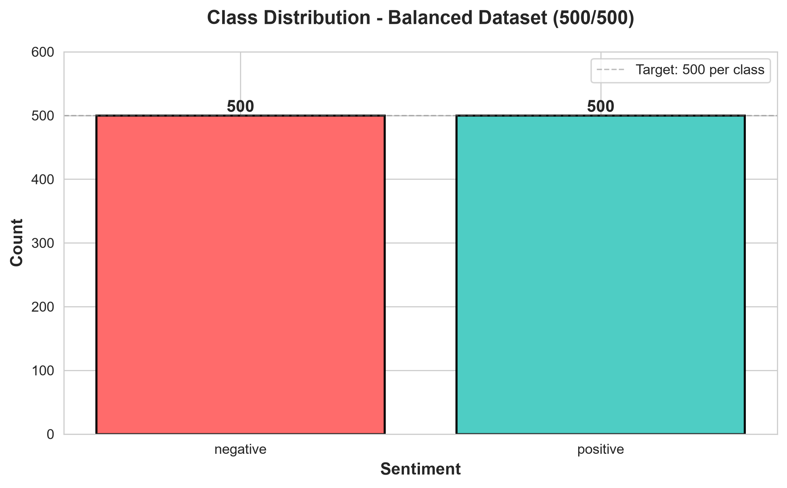

</div>
</div>

---

## 3. Exploratory Data Analysis & Preprocessing (`01_eda.ipynb`)

<div class="cols">
<div>

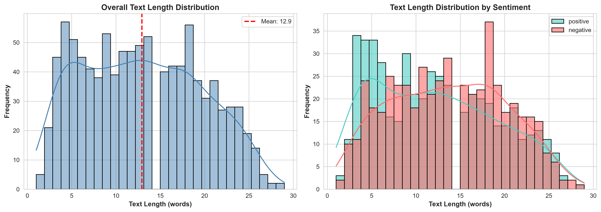

- **Brevity Insight**: Average cleaned length is **~7–13 tokens** (max ~30 tokens).
- **Pipeline**: Lowercasing → Regex punctuation stripping → NLTK + Reddit stopword removal (`cleaned_text`).

</div>
<div>

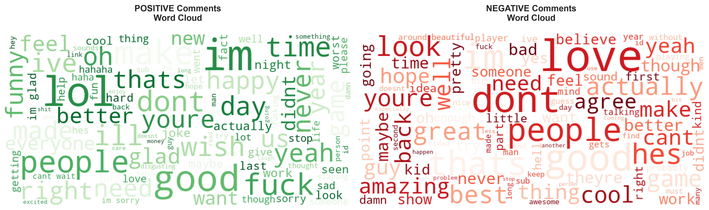

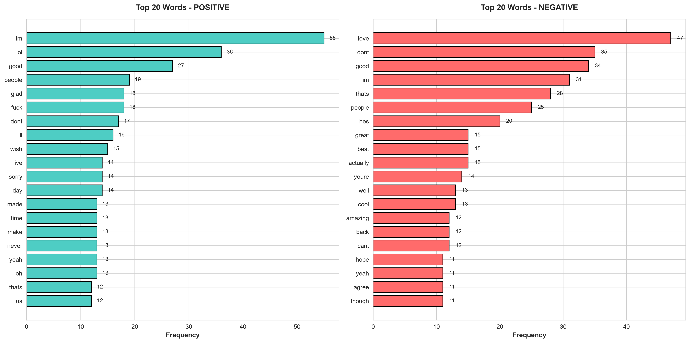

</div>
</div>

---

## 4. Chance-Level Floor: Dummy Baseline (`02_baseline_model.ipynb`)

<div class="cols">
<div>

### Establishing the Statistical Floor
Before training neural architectures, we establish a minimum no-skill threshold on the 200-comment test split using `DummyClassifier` over the 2,253-dim Bag-of-Words representation:

| Baseline Strategy | Accuracy | Precision | Recall | F1-Score | Cohen's $\kappa$ |
| :--- | :---: | :---: | :---: | :---: | :---: |
| **Most Frequent** | 0.500 | 0.000 | 0.000 | 0.000 | **0.000** |
| **Stratified (seed=42)** | 0.500 | 0.500 | 0.510 | 0.505 | **0.000** |

<div class="highlight">

**Statistical Interpretation**: A Cohen's $\kappa = 0.000$ is the exact mathematical expectation for random guessing on a balanced 50/50 split. Any valid neural architecture must achieve $\kappa \gg 0$.

</div>

</div>
<div>

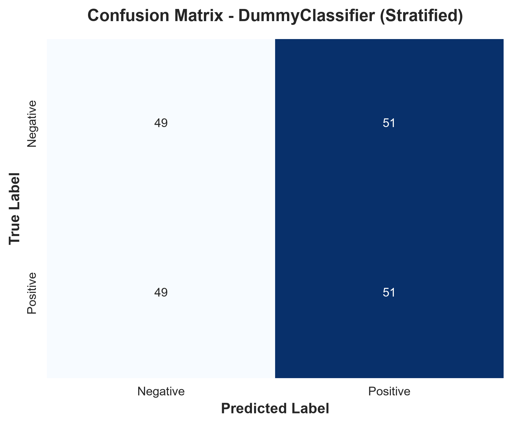

</div>
</div>

---

## 5. Classical Neural Architectures (`src/models.py`)

<div class="cols">
<div>

### 1. Dense NN (Bag-of-Words Input)
- **Input**: `CountVectorizer` ($2,253$ vocab features, no word order).
- **Layers**: `2253 → 256 → 128 → 1` with `ReLU` and `Dropout(0.3)`.

### 2. Bidirectional Vanilla RNN
- **Input**: Padded token indices (`max_len=30`, `vocab=2,254 → embed=64`).
- **Recurrence**: 1-layer Bidirectional RNN (`hidden=128` per dir → `256` concat).

### 3. Stacked Bidirectional LSTM
- **Input**: Same 30-token sequence (`embed=64`).
- **Recurrence**: 2 stacked Bidirectional LSTM layers with gated cell state $C_t$.

</div>
<div>

```python
# src/models.py — Modular PyTorch Architectures
class DenseNN(nn.Module):
    def __init__(self, input_dim: int, hidden_dims: List[int], dropout_rate=0.3):
        super().__init__()
        layers, prev_dim = [], input_dim
        for h_dim in hidden_dims:
            layers += [nn.Linear(prev_dim, h_dim), nn.ReLU(), nn.Dropout(dropout_rate)]
            prev_dim = h_dim
        layers.append(nn.Linear(prev_dim, 1))
        self.network = nn.Sequential(*layers)

class LSTMClassifier(nn.Module):
    def __init__(self, vocab_size, embedding_dim=64, hidden_dim=64, num_layers=2):
        super().__init__()
        self.embedding = nn.Embedding(vocab_size, embedding_dim)
        self.lstm = nn.LSTM(embedding_dim, hidden_dim, num_layers=num_layers,
                            bidirectional=True, batch_first=True, dropout=0.3)
        self.fc = nn.Linear(hidden_dim * 2, 1)

    def forward(self, x):
        _, (hidden, _) = self.lstm(self.dropout(self.embedding(x)))
        hidden_cat = torch.cat((hidden[-2], hidden[-1]), dim=1)
        return self.fc(self.dropout(hidden_cat))
```

</div>
</div>

---

## 6. Training Loop, Early Stopping & LSTM Grid Search (`src/train.py`)

<div class="cols">
<div>

### Shared Training Protocol
- **Loss & Optimizer**: `BCEWithLogitsLoss()` + `Adam` on CPU.
- **Early Stopping**: Restores `best_model_state` via `copy.deepcopy` when validation loss stops improving (`patience = 3–4`).

```python
# src/train.py — Checkpoint restoration on validation loss
if avg_val_loss < best_val_loss:
    best_val_loss = avg_val_loss
    best_model_state = copy.deepcopy(model.state_dict())
    patience_counter = 0
else:
    patience_counter += 1
    if patience_counter >= patience:
        break
model.load_state_dict(best_model_state)
```

</div>
<div>

### LSTM Manual Grid Search (12 Combinations)
Evaluated `hidden_dim ∈ {64, 128, 256}` × `lr ∈ {1e-3, 5e-4}` × `batch_size ∈ {32, 64}` (10 epochs, ranked by F1):

| Rank | `hidden_dim` | `lr` | `batch` | Val Acc | Val F1 | Val $\kappa$ |
| :---: | :---: | :---: | :---: | :---: | :---: | :---: |
| **#1** | **64** | **0.001** | **32** | **0.680** | **0.692** | **0.360** |
| #2 | 128 | 0.0005 | 32 | 0.665 | 0.663 | 0.330 |
| #12 | 256 | 0.0005 | 64 | 0.495 | 0.660 | -0.010 |

<div class="highlight">

**Finding**: Smaller capacity (`hidden_dim=64`) performed best during search; larger LSTMs (`256`) collapsed due to severe over-parameterization on 800 training samples.

</div>

</div>
</div>

---

## 7. Classical Models: Training Curves & Confusion Matrices

<div class="cols-3">
<div>

### Dense NN (BoW)
**Acc: 0.745 | F1: 0.749 | $\kappa$: 0.490**
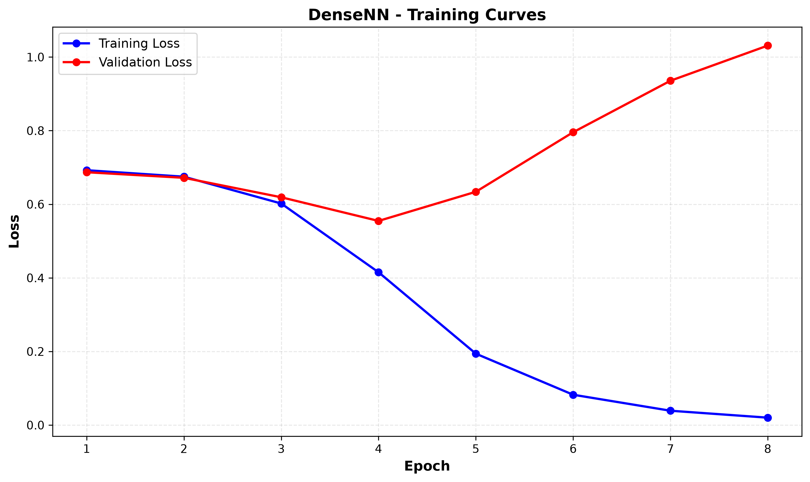
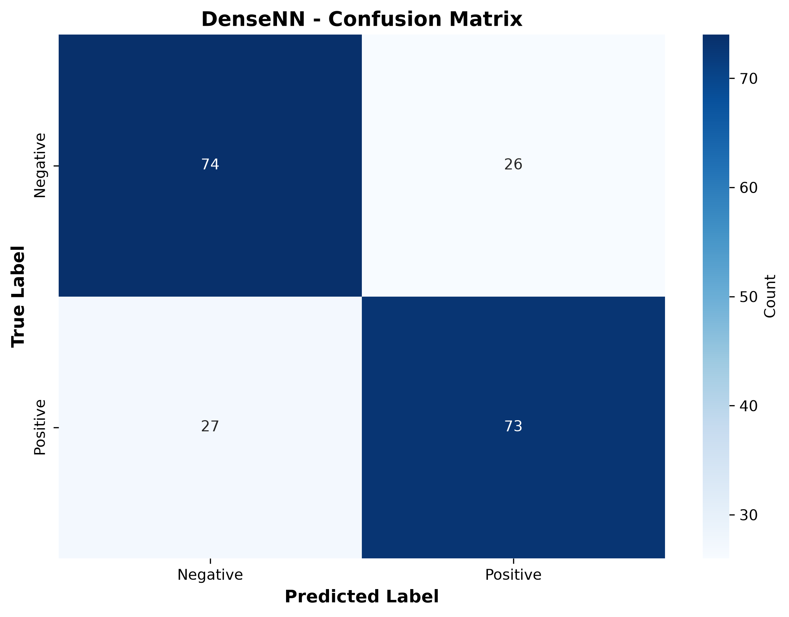

</div>
<div>

### Vanilla RNN
**Acc: 0.550 | F1: 0.622 | $\kappa$: 0.100**
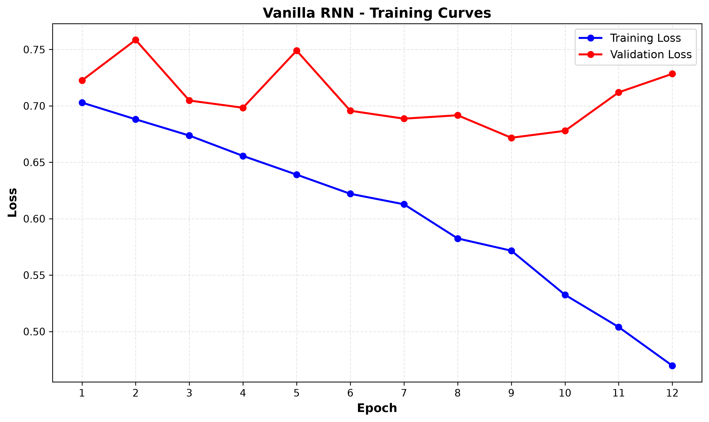
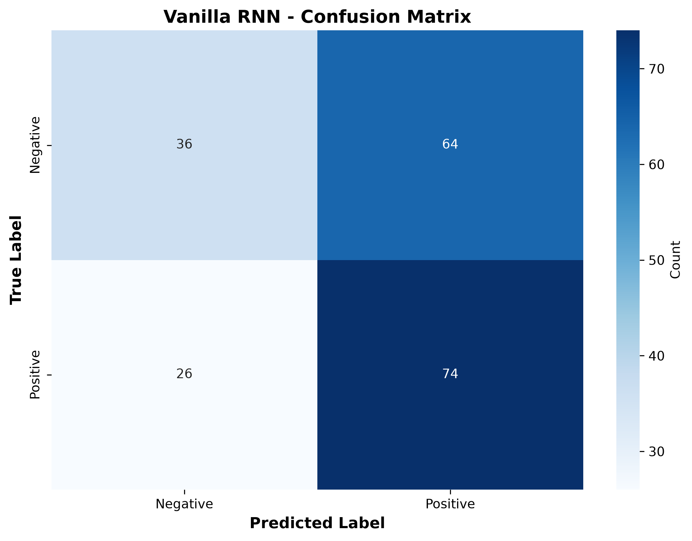

</div>
<div>

### LSTM (Final Retrained)
**Acc: 0.525 | F1: 0.582 | $\kappa$: 0.050**
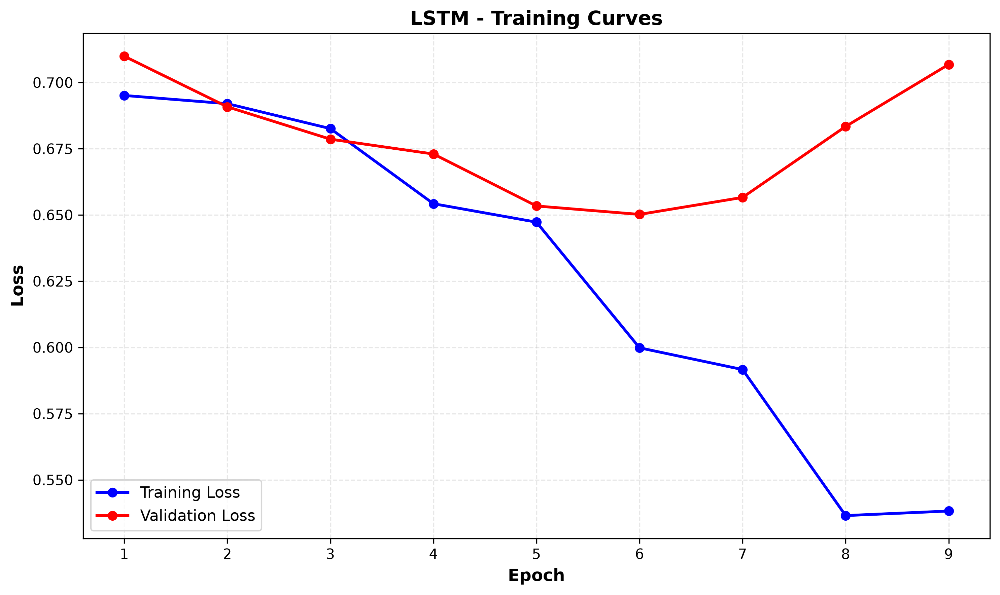
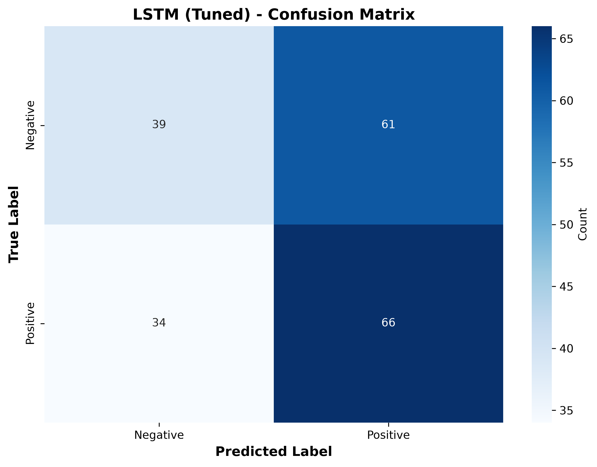

</div>
</div>

---

## 8. Transformer Extension: DistilBERT (`04_transformer_extension.ipynb`)

<div class="cols">
<div>

### Architecture & Fine-Tuning Setup
- **Backbone**: Pre-trained `distilbert-base-uncased` (66M params, 6 Transformer layers, 12 attention heads).
- **Tokenization**: `DistilBertTokenizerFast` (WordPiece, fixed `max_length = 64`).
- **Pooling**: Extracts `[CLS]` token (`last_hidden_state[:, 0, :]`) → custom 2-layer classification head.
- **Optimization**: `AdamW` (`lr = 2e-5`, `batch_size = 16`, 5 epochs) + **Gradient Clipping (`max_norm = 1.0`)**.

```python
# src/models.py — Custom DistilBERT Classifier
class TransformerSentiment(nn.Module):
    def __init__(self, model_name='distilbert-base-uncased', num_classes=2, dropout=0.3):
        super().__init__()
        self.distilbert = DistilBertModel.from_pretrained(model_name)
        h = self.distilbert.config.hidden_size  # 768
        self.classifier = nn.Sequential(
            nn.Dropout(dropout), nn.Linear(h, h // 2),
            nn.ReLU(), nn.Dropout(dropout), nn.Linear(h // 2, num_classes)
        )
    def forward(self, input_ids, attention_mask):
        cls_out = self.distilbert(input_ids, attention_mask).last_hidden_state[:, 0, :]
        return self.classifier(cls_out)
```

</div>
<div>

### Test Set Results (200 Samples)
- **Accuracy**: `0.775` (155 / 200 correct)
- **Precision**: `0.762` | **Recall**: `0.800`
- **F1-Score**: `0.780` | **Cohen's $\kappa$**: `0.550`

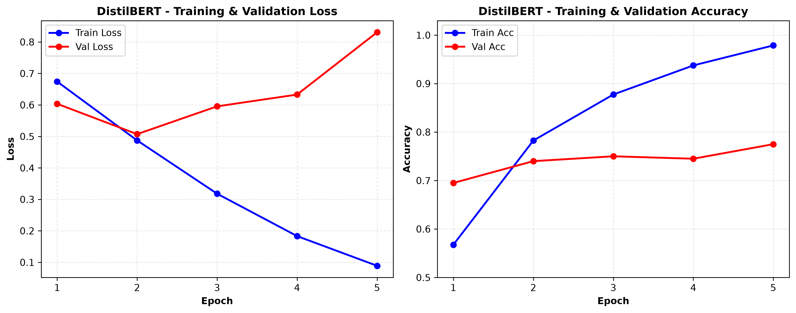
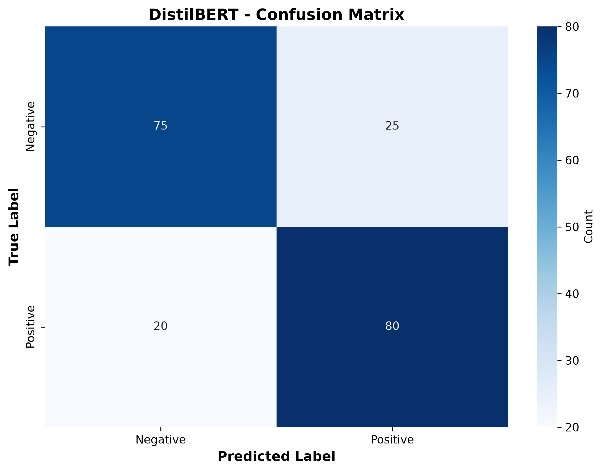

</div>
</div>

---

## 9. Global Empirical Comparison Across All Models

<div class="cols">
<div>

| Model | Acc | Prec | Rec | F1 | $\kappa$ | CM |
| :--- | :---: | :---: | :---: | :---: | :---: | :---: |
| **Dummy (Most Freq)** | 0.500 | 0.000 | 0.000 | 0.000 | 0.000 | `[[100,0],[100,0]]` |
| **Dummy (Stratified)** | 0.500 | 0.500 | 0.510 | 0.505 | 0.000 | `[[49,51],[49,51]]` |
| **LSTM (Tuned Final)** | 0.525 | 0.520 | 0.660 | 0.582 | 0.050 | `[[39,61],[34,66]]` |
| **Vanilla RNN (Bi)** | 0.550 | 0.536 | 0.740 | 0.622 | 0.100 | `[[36,64],[26,74]]` |
| **Dense NN (BoW)** | **0.745** | **0.738** | **0.760** | **0.749** | **0.490** | `[[73,27],[24,76]]` |
| **DistilBERT (Ext.)** | **0.775** | **0.762** | **0.800** | **0.780** | **0.550** | `[[75,25],[20,80]]` |

<div class="highlight" style="font-size: 0.78em; padding: 6px 10px;">

**Expected**: `DistilBERT > LSTM > RNN > Dense NN > Dummy`
**Actual**: **`DistilBERT > Dense NN > Vanilla RNN > LSTM > Dummy`**
• **Short texts (~13 words)**: Keywords dominate over long-range syntax.
• **800 train samples**: Insufficient for recurrent gates from scratch.

</div>

</div>
<div>

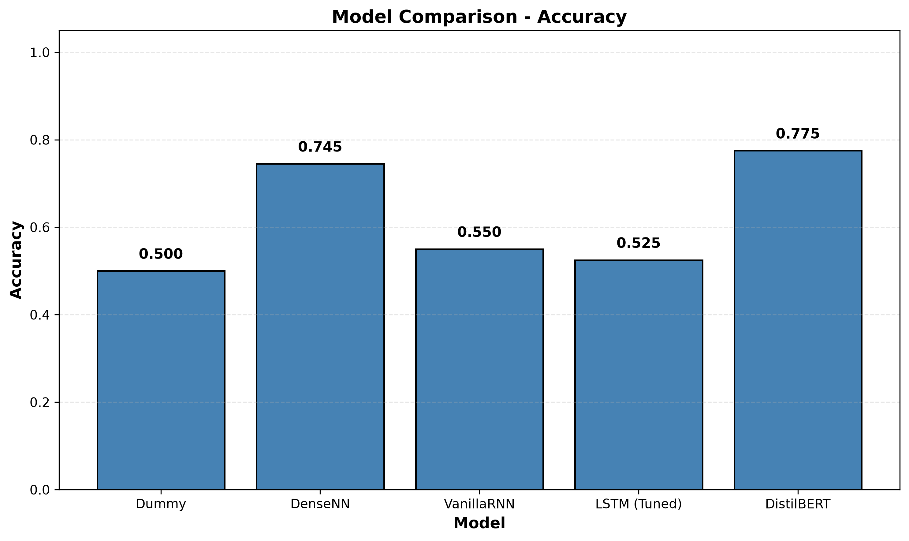
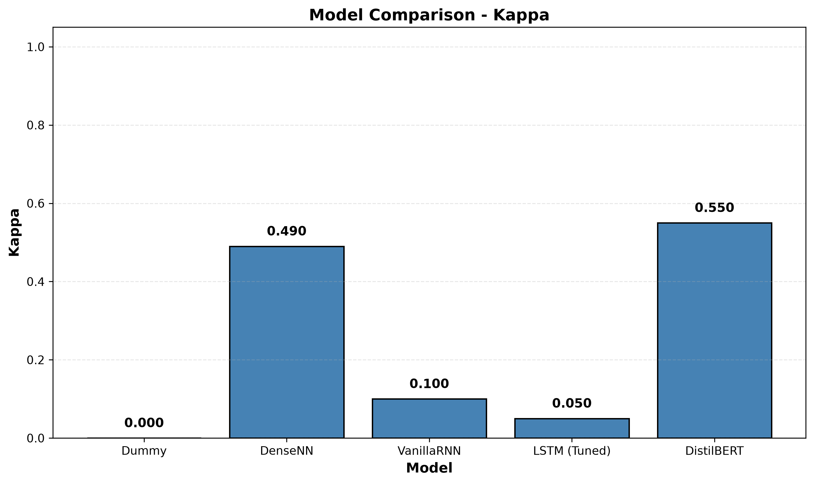

</div>
</div>

---

## 10. Theoretical Analysis: Connection to Turing Machines (OE3.3–OE3.6)

<div class="cols">
<div>

### Recurrent Networks vs. Classical Turing Machines
Following **Siegelmann & Sontag (1992)**:
- **Tape & Internal State ($Q, \Gamma$)**: Encoded within the fixed-dimension hidden vector $h_t \in \mathbb{R}^d$.
- **Transition Function ($\delta$)**: Parameterized by the recurrent step $h_t = \tanh(W_h h_{t-1} + W_x x_t + b_h)$.
- **LSTM Gated Tape**: Cell state $C_t$ acts as an explicit read/write/erase memory register controlled by forget ($f_t$), input ($i_t$), and output ($o_t$) gates, mitigating vanishing gradients across sequential head movements ($O(n)$ steps).

</div>
<div>

### Transformers & Parallel Random-Access Memory
- **Breaking Sequential Tape Traversal**: Self-attention computes pairwise token interactions in $O(1)$ sequential path length ($O(n^2)$ parallel operations):
  $$\text{Attention}(Q,K,V) = \text{softmax}\left(\frac{QK^T}{\sqrt{d_k}}\right)V$$
- **Bounded Formal Automata in Practice**:
  - Idealized RNNs and Transformers with infinite precision and unbounded context are **Turing-complete** (Pérez et al., 2021).
  - **In our implementation**: IEEE-754 floating-point precision (`float32`) and fixed windows (`30` or `64` tokens) constrain all models to **bounded Finite State Automata**.

</div>
</div>

---

## 11. Conclusions, Limitations & Future Work

<div class="cols">
<div>

### Key Takeaways
1. **Pre-trained Self-Attention Wins**: **DistilBERT** achieved the strongest generalization (**Acc: 0.775, F1: 0.780, $\kappa$: 0.550**), leveraging contextual subword embeddings and $O(1)$ direct memory access.
2. **Simplicity Beats Sequential Recurrence on Small Short-Text Corpora**: **Dense NN (BoW)** (**Acc: 0.745, $\kappa$: 0.490**) strongly outperformed **Vanilla RNN** ($\kappa = 0.100$) and **LSTM** ($\kappa = 0.050$) built from random embeddings on 800 samples.
3. **Computability Alignment**: Theoretical expressiveness (LSTM gates vs. BoW) only translates into empirical gain when dataset scale and sequence length justify sequential state transitions.

</div>
<div>

### Scope Limitations & Future Work
- **Sample Size Scope**: Results characterize the **1,000-comment balanced subset** (`seed=42`) and must not be extrapolated to the full 29,991-comment GoEmotions corpus without re-training.
- **Pre-trained Embeddings for Recurrent Models**: Initializing RNN/LSTM with GloVe or FastText vectors would isolate sequential recurrence from embedding cold-start.

### Key References
1. **Demszky et al. (2020)**. *GoEmotions: A Dataset of Fine-Grained Emotions*. ACL.
2. **Hochreiter & Schmidhuber (1997)**. *Long Short-Term Memory*. Neural Computation.
3. **Siegelmann & Sontag (1992)**. *On the computational power of neural nets*. COLT.
4. **Sanh et al. (2019)**. *DistilBERT, a distilled version of BERT*. arXiv:1910.01108.
5. **Vaswani et al. (2017)**. *Attention Is All You Need*. NeurIPS.

</div>
</div>
